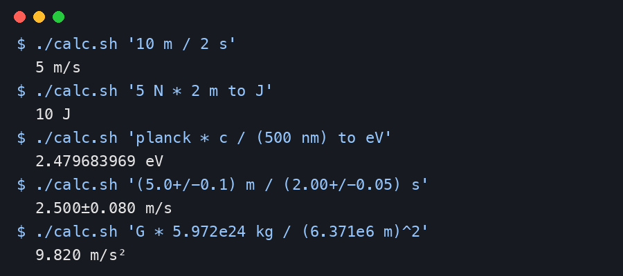

# Physics Calc for Alfred

Calculate with real units, physics constants, and measurement uncertainty from Alfred, powered by [Qalculate](https://qalculate.github.io).

## Install

1. Install Qalculate's command-line tool: `brew install libqalculate`
2. Download [Physics-Calc.alfredworkflow](https://github.com/psagap/alfred-physics-calc/releases/latest/download/Physics-Calc.alfredworkflow) and double-click it.

Requires Alfred 5 with the Powerpack. If `qalc` is missing, the workflow shows a result that copies the install command.

## Usage

Type the keyword (default `calc`, configurable) followed by an expression.

- `↩` copy the result
- `⌘↩` paste the result into the front app
- `⌥↩` copy the full line (expression = result)

```
calc 10 m / 2 s                          → 5 m/s
calc 5 N * 2 m to J                      → 10 J
calc 60 mph to m/s                       → 26.8224 m/s
calc planck * c / (500 nm) to eV         → 2.479683969 eV
calc (5.0+/-0.1) m / (2.00+/-0.05) s     → 2.500±0.080 m/s
calc G * 5.972e24 kg / (6.371e6 m)^2     → 9.820 m/s²
calc solve(x^2 + 2x = 8)                 → [2, -4]
```

The image below is a terminal capture of the workflow script's real output, rendered as an image. It is not a screenshot of Alfred.



## Notes

- Units simplify automatically (N·m → J, V/Ω → A). Convert with `to`, e.g. `0.0063 m to mm`.
- Constants: `c`, `G`, `planck`, `hbar`, `k_B`, `N_A`, `q_e`, `m_e`, `g0`, `epsilon_0`, `mu_0`. A bare `e` is Euler's number.
- Uncertainty: write `(value+/-error)` and it propagates.
- Trig uses degrees (`sin(90) = 1`); add `rad` for radians.
- `\` is treated as normal division.
- Results ignore your personal `qalc.cfg`, so they are always the same.

## Source

The workflow files are in [`workflow/`](workflow). The script is plain zsh calling `qalc`, with no compiled binaries.

## License

[MIT](LICENSE)
